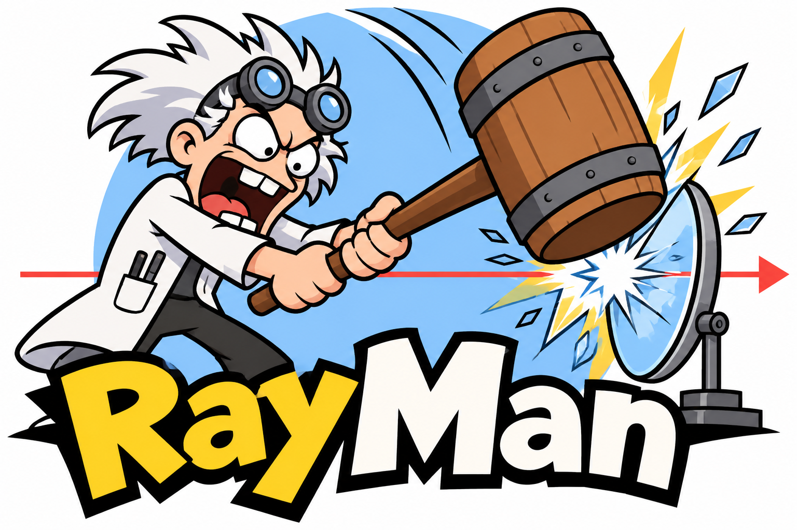

# RayMan



A bench for tracing rays by hand, for lectures and practice. You place thin ideal lenses and
draw rays yourself; RayMan keeps lines straight and snaps things into place. It does not trace
for you. See [`Claude/goal.md`](Claude/goal.md) for the brief.

**Authorship.** The code was written by Claude (Anthropic's model, working in Claude Code),
directed by the course lecturer. [`Claude/LOG.md`](Claude/LOG.md) records what was built, the
decisions made along the way, and why.

## Running it

Open `index.html` in a browser (Chrome, Safari, Firefox or Edge). There is no build step and no
internet connection needed, so it also works from a USB stick in a lecture theatre. It can be
hosted as static files anywhere.

The tools are in the rail on the right; hover over one to see its name and shortcut, or press
`?` for help. The bench is kept in the browser between visits. Use the File menu to save a
scene as a `.json` file or to save a picture.

## Status

- **Phase 1 (done):** grid and optical axis, pan/zoom, thin lenses (place, drag, f ±, aperture,
  focal planes), object arrows, point sources, snapping (a lens's centre, F or F′ lines up with
  other lenses' focal points, 2F points and centres, else the grid), properties panel,
  undo/redo, save/load, PNG export, light and dark themes.
- **Phase 2 (done):** drawing rays with snapping and highlights (parallel to the axis, through
  F/F′/lens centres, straight on). Rays stop at the next lens, can be continued, branched and
  extended, and follow when the optics move (this can be switched off).
- **Phase 3:** recognising parallel/focal/central rays (optional colour coding), automatic
  images (real and virtual) that act as objects for the next lens.
- **Phase 4:** tilted parallel bundles, 4f relays, scan-mirror pivot.

## Code

| File | What it does |
|---|---|
| `js/geom.js` | Pure geometry (no DOM): grid steps, focal points, intersections, refraction |
| `js/scene.js` | The scene model (elements and rays), save/load with validation, undo history |
| `js/snap.js` | Snapping rules for dragging things on the bench |
| `js/rays.js` | Solving rays from what they are pinned to, snapping while drawing, freezing ("baking") |
| `js/view.js` | World (mm, y up) ↔ screen transform, pan and zoom |
| `js/render.js` | All canvas drawing and the colour themes |
| `js/panel.js` | The properties panel for the selected element or ray |
| `js/app.js` | Tools, pointer and keyboard handling, popovers, files, start-up |

The files are classic scripts sharing a `window.RM` namespace, so the page works when opened
straight from disk. `geom.js`, `scene.js`, `snap.js`, `rays.js` and `view.js` can also be
`require`d by Node, which is how they are tested:

```
node --test tests/
```
