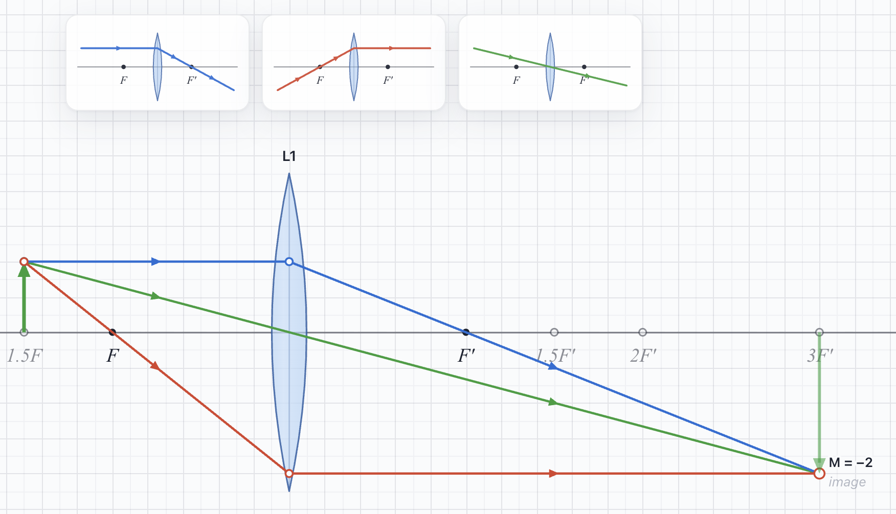
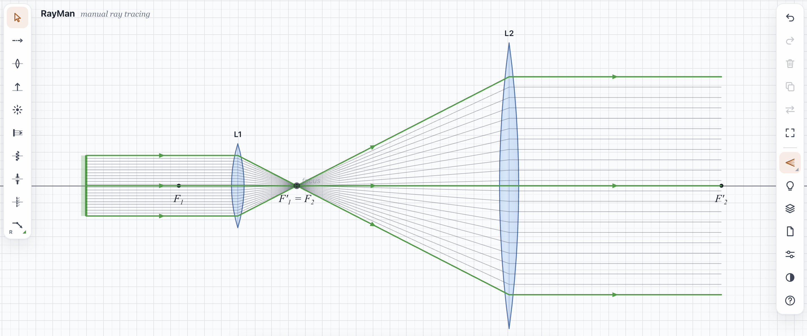
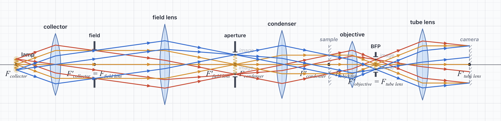

# RayMan


[RayMan](https://swcmicroscopy.com/RayMan) is designed to help teach basic paraxial optics with ideal lenses. It provides a canvas upon which you can add lenses to an optical axis and tracing rays by hand, for lectures or learning. You place thin ideal lenses and draw rays yourself; RayMan keeps lines straight and snaps things into place. It does not trace for you.




## Running it

You can find a running instance of RayMan at [swcmicroscopy.com/RayMan](https://swcmicroscopy.com/RayMan/) but you can also clone the repo and open the `index.html` in a browser. RayMan's help page is available via its `?` icon or you can go [swcmicroscopy.com/RayMan/guide](https://swcmicroscopy.com/RayMan/guide/index.html).


## What is available

You can place lenses, objects, lamp filaments, collimated beams, irises, image planes, and rays. There are helper rays to assist with drawing rays. Rays will automatically snap to relevant places and also snap to make them parallel to other relevant items, such as helper rays or the optical axis.  You may place multiple optical axes on one canvas.

Your bench persists across visits from one browser and you can use the File menu to save a scene as a `.json` file or to save a picture. The File menu also copies a link that opens the scene in RayMan, or HTML that embeds the diagram, read-only, in a web page ([examples](https://swcmicroscopy.com/RayMan/examples/embed/)).

RayMan has been tested on iPad with an Apple Pencil. You can use Safari's Share → **Add to Home Screen** to install RayMan as an app (its own icon, no browser bars). It will run offline but still loads from the website, so it updates with it; its saved bench is separate from Safari's (use File → Save / Open to move work across).

### Example: a beam expander

In the example below we trace a beam expander with RayMan. The example uses two lenses and the collimated beam item, which includes three beams the user must trace through the system with the ray tool. The grey shaded rays are added afterwards using the optional ray-fill tool, which is off by default.




### Example: Köhler illumination

It is possible to ray-trace Köhler illumination, if you are patient!




## Putting it on your own website

Copy the files (not `Claude/`, `tests/`, `tools/`) to the server, then stamp the copy:

    python3 tools/stamp-assets.py <the copy>

This adds `?v=<content hash>` to every script, stylesheet and image link in the copied pages, so
browsers (Safari on iPad above all) never keep running an old version after an update. The
`.htaccess` file makes Apache servers tell browsers to check for a newer page on every visit.
The repository's own files stay unstamped, so RayMan still opens straight from disk.


## Code

| File | What it does |
|---|---|
| `js/geom.js` | Pure geometry (no DOM): grid steps, focal points, intersections, refraction |
| `js/scene.js` | The scene model (elements and rays), save/load with validation, undo history |
| `js/snap.js` | Snapping rules for dragging things on the bench |
| `js/rays.js` | Solving rays from what they are pinned to, finding images, recognising principal rays, snapping while drawing, freezing ("baking") |
| `js/view.js` | World (mm, y up) ↔ screen transform, pan and zoom |
| `js/render.js` | All canvas drawing and the colour themes |
| `js/share.js` | Scenes in links, the embed code, fitting a scene in view |
| `js/panel.js` | The properties panel for the selected element or ray |
| `js/app.js` | Tools, pointer and keyboard handling, popovers, files, start-up |
| `embed.js` | Draws scenes, read-only, in other web pages |

The files are classic scripts sharing a `window.RM` namespace, so the page works when opened
straight from disk. `geom.js`, `scene.js`, `snap.js`, `rays.js`, `view.js` and `share.js` can also be
`require`d by Node, which is how they are tested:

```
node --test tests/
```
