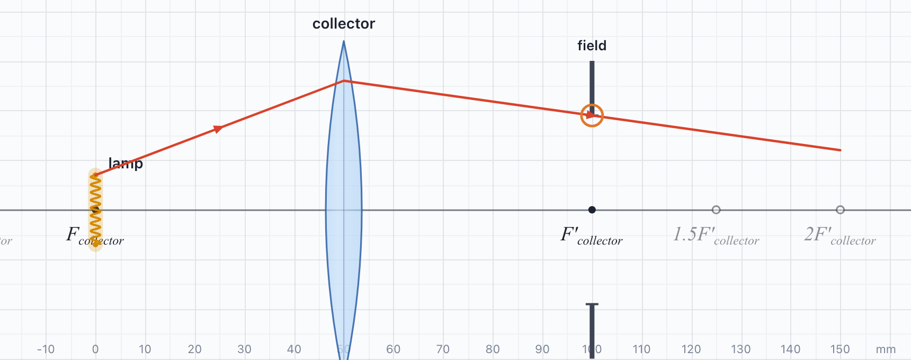
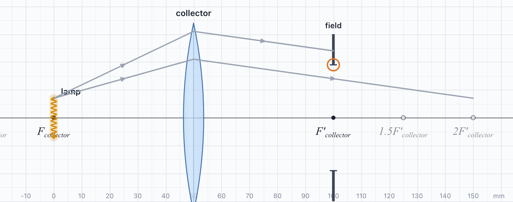
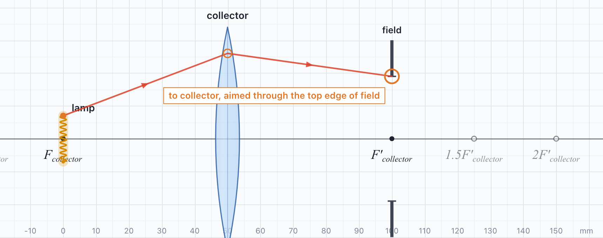
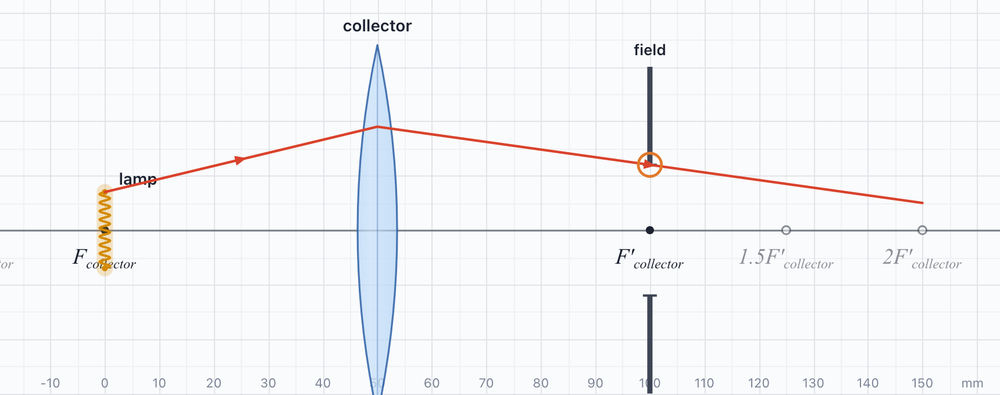

# RayMan TODO — ideas to ponder

Found while building Köhler illumination (see `examples/kohler/`). Not decided yet: teaching is the
goal, and drawing rays slowly by hand has benefits.

## 1. Aim a ray "through a point after the lens"

**What you want to draw.** In Köhler illumination you often want *the* ray from a lamp point that
just grazes the edge of the field diaphragm, which sits *after* the collector. The lens bends the
ray, so it has to hit the collector at one particular height (here 26 mm) to come out through the
edge.

**What you can do today.** You click the ray onto the collector at a height you choose, and then
bend it. RayMan cannot tell you which height reaches the edge, so you guess (grey: one passes
below the edge, one hits the blade), or work it out by hand (26 = 19 + 7, as the lamp is at F), or
draw the ray backwards from the edge and reverse it (Shift+R). None of these suits a lecture.

**The proposal: one new snap.** While you draw from the lamp point, move the cursor *past* the
collector, onto the diaphragm's edge. RayMan offers *"to collector, aimed through the top edge of
field"* and previews both pieces: the ray to the collector at the right height, and the bent ray on
to the edge. One click places both. (Mock-up: this snap does not exist yet.)

**It stays aimed.** Like "bent by", the ray remembers what it was aimed at. Close the field
diaphragm (here from 19 to 12) and the ray moves so that it still grazes the edge. The same if the
lamp, the collector or its f changes.

The same snap would work for any point after one lens: an iris edge, an image, F′, a point on the
sample or camera marker, a point on another ray.

**How (for Claude).** The first segment gets a new rule, `{ kind: 'via', el: L, at: A }`. For a
thin lens the height has a closed form, with a = L.z − P.z, b = A.z − L.z:

    h = (A.y + P.y·b/a) / (1 + b/a − b/f)

Not offered when A is P's own image (every height works). One lens only. Works backwards too.
Reversing such a ray turns it into a fixed slope (as `refract` does now). The pictures are made
by `Claude/guide-shots/todo_aim.py`.

## 2. Fewer clicks per bundle

**Where the clicks go now.** For each ray at each lens: click its end, aim "straight on" to the
lens, click, click the end again, aim "bent by". Through an image add a Shift-click. The Köhler
demo (8 rays, 4 lenses) took about 100 clicks, nearly all repeating the lens law.

**Proposal, in two steps.**
- **a.** Double-click a ray's end on a lens: continue it "bent by" that lens to the next lens, image
  plane or edge. If it forms a real image on the way, it carries straight on through it. Today
  double-click only extends in a straight line. About one double-click per ray per lens.
- **b.** Shift-double-click: the same for every ray from the same source point (e.g. all rays from
  the filament top) that ends on that lens. One action per bundle per lens: about 12 actions for
  the Köhler demo instead of about 100.

**Teaching risk.** RayMan does not trace rays for you. Both steps keep the student choosing where
to go, one lens at a time; they only stop the lens law being redone by hand. Option: (b) only works
once one ray of the bundle has been bent by hand at that lens.

## Smaller ones, from the same exercise

- Images of iris edges (the field diaphragm imaged on the sample) are not marked as images; only
  images of light sources are.
- Reversing a ray turns "bent by" into a fixed slope, so it no longer follows when the lamp moves.

## From the second Köhler build (2026-11-14, the demo's real layout)

- Field points (rays from different lamp points crossing on the field diaphragm, the sample, the
  camera) are not marked: images are only of light sources. The demo marks them with dots.
- The weak "point on a ray" snap is ~12 px wide: a click 1 mm from another ray's point on a lens
  stays on that point even zoomed in 4×. Alt (no snapping) gets round it.
- The "image" labels of the lamp images sit on top of the F′ = F labels at the same planes.
- Fit (F) puts the lamp's F label under the left toolbar and the camera label at the right edge.

## Vertical stretch (parked, 2026-11-14)

Proposed from the *confocal-from-zero* demo, which stretches its pictures vertically so that beams
a few degrees off the axis can be seen. The lecturer called it "a nice idea" without asking for it
yet. It would be a view setting (×1, ×2, ×3): parallel lines stay parallel and crossings stay put,
so constructions are unchanged. The work is in hit-testing and snapping, which measure distances
in mm and would need to measure them on screen instead; lens shapes and labels must not stretch.
